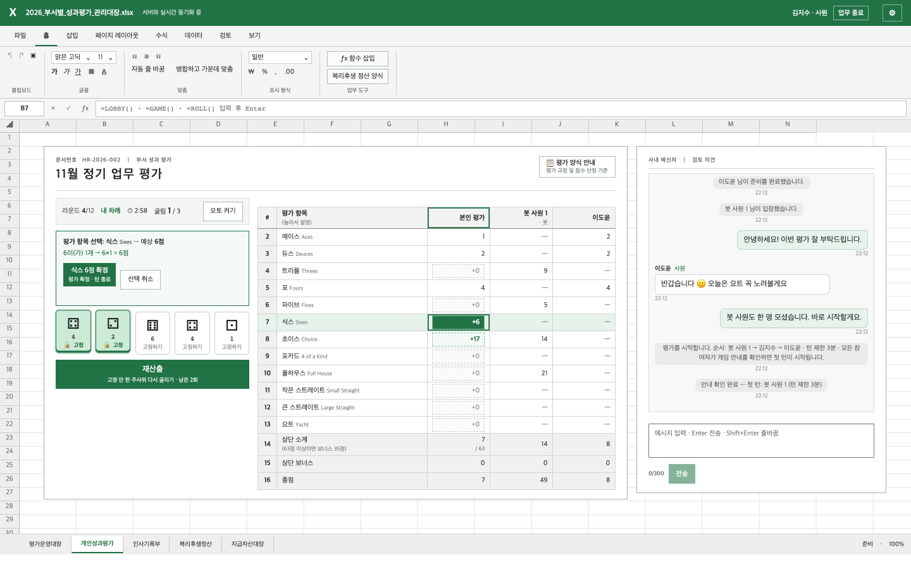
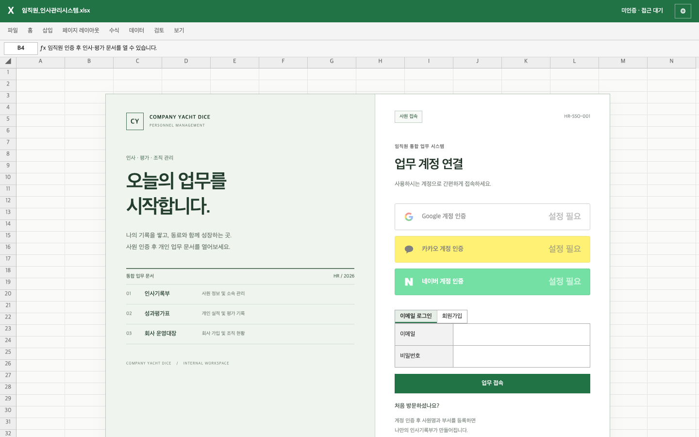
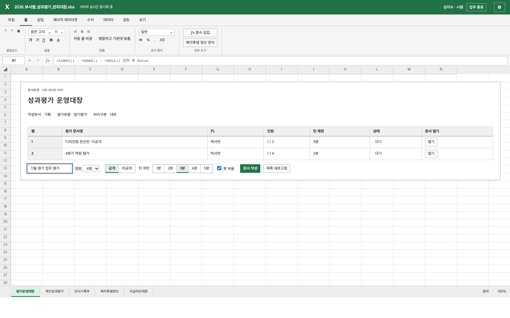
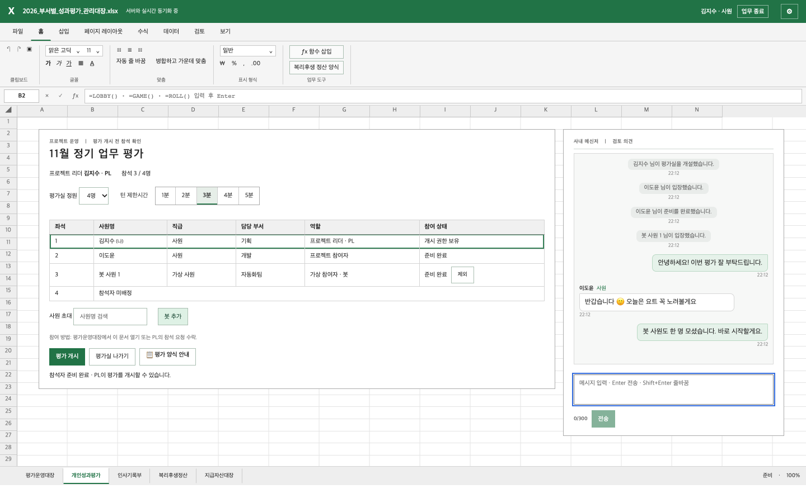
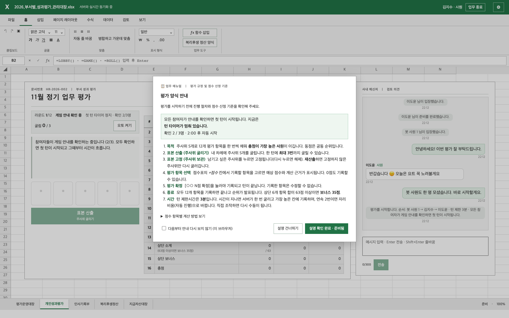
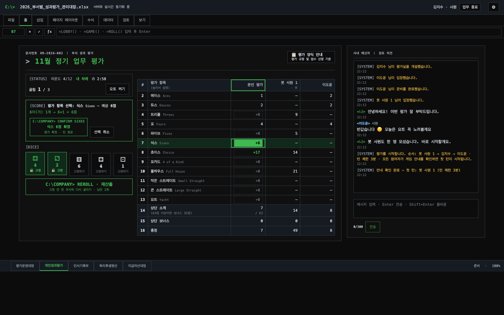
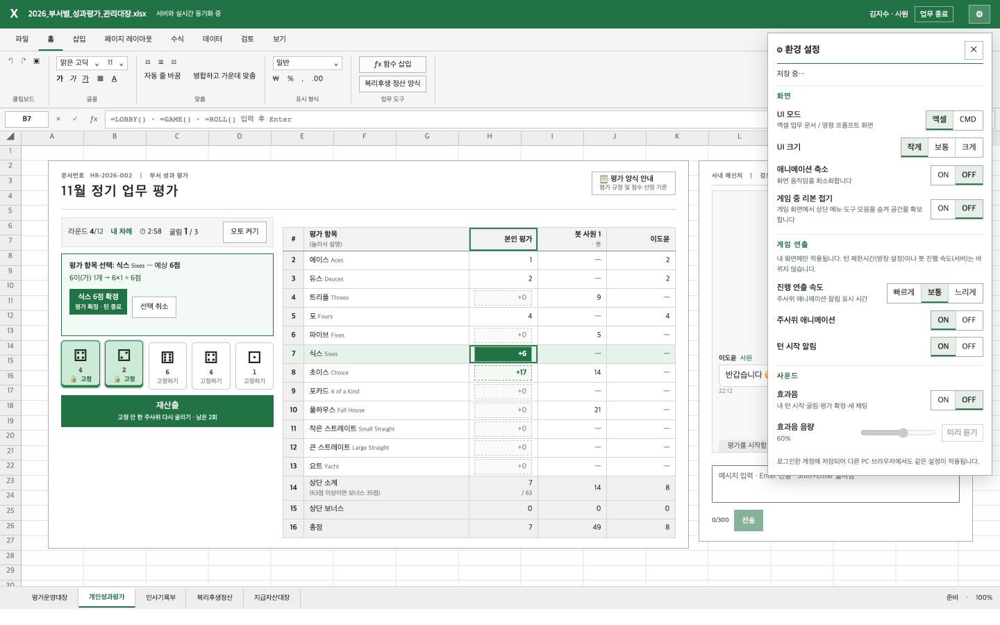
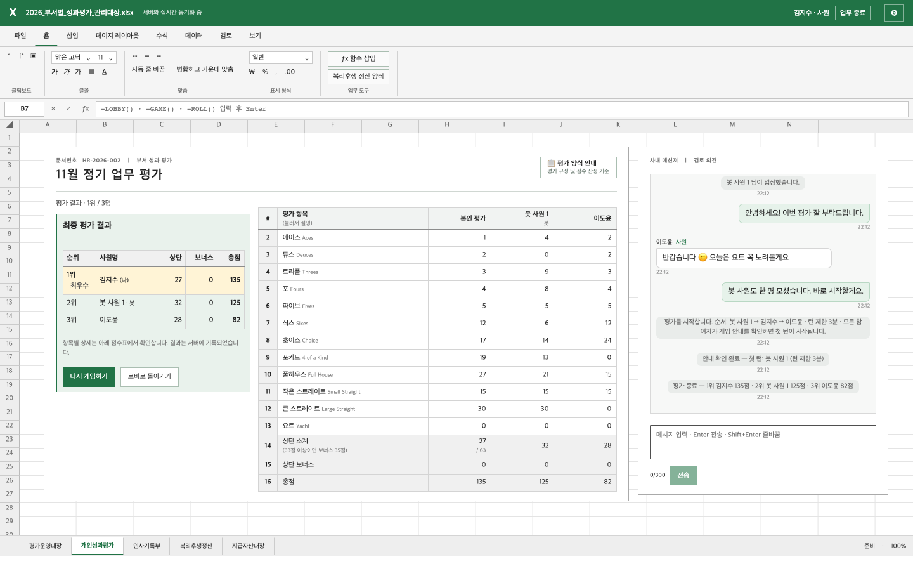
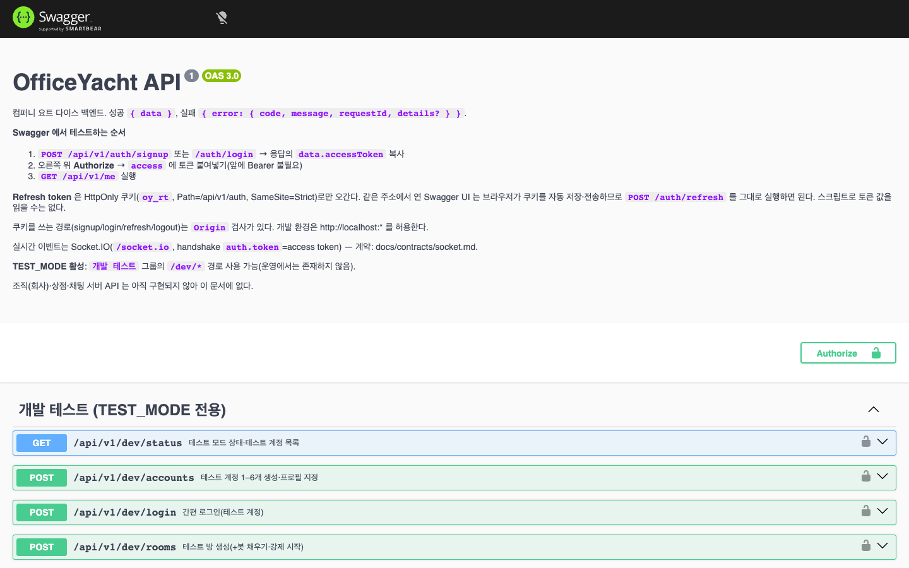
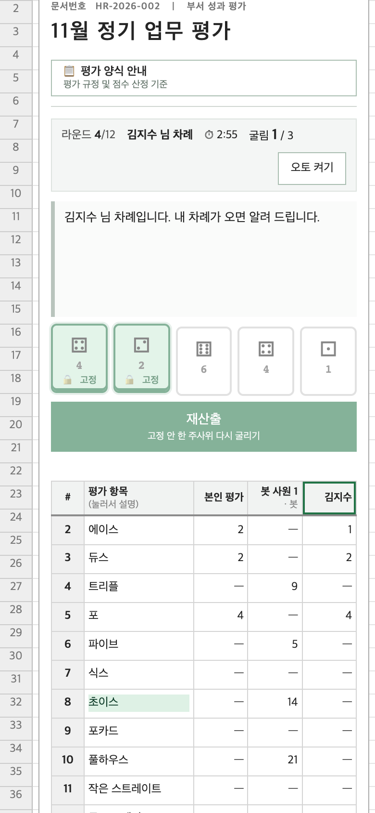

# 컴퍼니 요트 다이스 · OfficeYacht

> 엑셀 업무 문서처럼 보이는 화면에서 동료들과 실시간으로 즐기는 **요트 다이스**.
> 게임방은 "평가실", 주사위 굴리기는 "표본 산출", 점수 기록은 "평가 확정"입니다.



- **2–6인 실시간 멀티플레이**: 서버가 주사위·점수·턴·권한을 모두 판정하고, 모든 참여자가 같은 상태를 봅니다(Socket.IO)
- **처음 하는 사람도 쉽게**: 시작 전 규칙 안내(첫 턴 타이머는 그동안 정지), 다음 행동 안내, 선택 → 확정 2단계, 점수 계산 근거 표시
- **회사원 콘셉트**: 사내 메신저 채팅, 사원 초대, 비공개 평가실(입장 코드), PL 권한, 봇 사원
- **엑셀 / CMD 두 가지 화면**: ⚙ 환경 설정에서 바로 전환하며, 계정별로 저장됩니다
- **혼자서도 테스트 가능**: 개발용 DEV 패널(봇 채우기·강제 시작·종료 시뮬레이션)

---

## 화면

| 접속 | 로비(평가운영대장) |
|---|---|
|  |  |
| **대기실 · 사내 메신저** | **시작 전 평가 양식 안내** |
|  |  |
| **게임: 표본 고정 · 평가 항목 선택** | **CMD 모드** |
|  |  |
| **⚙ 환경 설정** | **최종 평가 결과** |
|  |  |
| **API 문서(Swagger)** | **모바일** |
|  |  |

## 게임 방법

1. 로비에서 평가실을 만들거나(정원 2–6, 턴 제한 1–5분, 공개/비공개, 봇 허용) 목록에서 입장합니다.
2. 참여자가 **준비**를 누르면 PL이 **평가 개시**를 누릅니다. 모두 안내를 확인하면 첫 턴이 시작됩니다.
3. 내 차례: **표본 산출**(굴리기) → 남길 주사위를 눌러 **고정** → **재산출**(최대 3회).
4. 점수표의 `+점수` 칸으로 항목을 **선택**하면 계산 근거가 나오고, **[항목 N점 확정]**을 누르면 기록됩니다.
5. 12개 항목을 모두 채우면 끝납니다. 상단 6항목 합이 63점 이상이면 보너스 35점이고, 총점이 가장 높은 사원이 이깁니다.

## 기술 스택

| 영역 | 사용 |
|---|---|
| Web | Vue 3.5 · Vite 8 · socket.io-client |
| API | NestJS 12 (ESM) · TypeScript 6 · zod 4 · jose(JWT) · Socket.IO 4 · Swagger(OpenAPI 3) |
| Data | PostgreSQL 18 · Prisma 7 · Redis 8 |
| Game | `packages/shared` 순수 엔진(웹·서버 공유) |
| Test | Node test runner · 실제 Chrome E2E(playwright-core) |
| Infra | Docker Compose (Apple Silicon / amd64), EC2 이전 가이드 포함 |

## 빠른 시작

요구 사항: **Node 24**(≥24.11), Docker Desktop

```sh
# 1) 비밀값 생성(.env 2개, 값은 화면에 출력하지 않음) + PostgreSQL·Redis 실행
npm run env:init
npm run infra:up

# 2) API 서버  → http://localhost:3000  (API 문서: /docs)
npm run server:install
npm run server:migrate
npm run server:dev

# 3) 웹  → http://localhost:5173 (포트가 사용 중이면 Vite가 다음 포트로 엽니다)
cd apps/web && npm ci && npm run dev
```

혼자 테스트할 때는 `apps/server/.env`에 `TEST_MODE=true`를 두세요(로컬 DB에서만 켜집니다). 웹 오른쪽 아래 **DEV 테스트 패널**에서 테스트 계정으로 접속하고, 봇과 함께 바로 게임할 수 있습니다. 두 명으로 테스트하려면 시크릿 창에서 다른 계정으로 접속하세요.

소셜 로그인(Google·카카오·네이버)은 공급자 콘솔에서 받은 Client ID 등을 `.env`에 넣어야 켜집니다 → [설정 방법](docs/social-login-setup.md)

## 테스트

```sh
npm --prefix apps/server test                 # 서버 단위·E2E (PG·Redis 필요)
(cd packages/shared && node --test)           # 게임 엔진
cd apps/web
WEB_URL=http://localhost:5173 npm run test:e2e       # 게임·멀티플레이(실제 Chrome)
WEB_URL=http://localhost:5173 npm run test:layout    # 반응형 레이아웃 5구간
WEB_URL=http://localhost:5173 npm run test:settings  # 환경 설정·Excel/CMD·계정별 저장
```

최근 결과(2026-11-09): 서버 68/68, 엔진 9/9, 브라우저 E2E 18/18 · 23/23 · 18/18

## 디렉터리

| 경로 | 역할 |
|---|---|
| `apps/web/` | Vue 화면(로그인·로비·대기실·게임·채팅·설정·DEV 패널), `e2e/` 브라우저 테스트 |
| `apps/server/` | NestJS API·Socket.IO·Prisma, `test/` 서버 테스트 |
| `packages/shared/` | 점수·턴 엔진·오토 전략(순수 함수) |
| `infra/` | Docker Compose, 환경변수 생성·백업 스크립트, [실행·EC2 안내](infra/README.md) |
| `docs/` | 명세·계약·현황 문서 |
| `unity/OfficeWorld/` | 3D 사무실(예정) |

## 문서

| 문서 | 내용 |
|---|---|
| [docs/SPEC.md](docs/SPEC.md) | **기능 명세서(전체 요약)** |
| [docs/development-status.md](docs/development-status.md) | 구현 상태·게임 흐름·소켓 이벤트·데이터 구조·테스트 |
| [docs/features/](docs/features) | 기능별 상세(인증·로비·요트 규칙·채팅·설정 등) |
| [docs/contracts/](docs/contracts) | REST·Socket.IO 계약 |
| [docs/db.md](docs/db.md) | 데이터 모델 |
| [docs/infrastructure.md](docs/infrastructure.md) | 인프라 버전·검증 결과 |
| [docs/codemap.md](docs/codemap.md) | 파일 위치 지도 |
| [docs/HANDOFF.md](docs/HANDOFF.md) | 작업 인수인계 기록 |

## 현재 범위와 다음 단계

- 서버 미구현(화면은 로컬 목업): 회사(조직)·상점·재화·칭호
- 예정: 직급 체계와 직급별 이모지, 회사 등급 특수 능력, CMD 명령어 입력, 소셜 로그인 실연동 검증
- 설계: [docs/tasks/GAME-ROOM-001.md](docs/tasks/GAME-ROOM-001.md)

## 개발 협업 메모

Claude Code와 Codex를 함께 사용합니다. 각 도구는 `CLAUDE.md`·`.claude/rules/`(경로별 규칙)·`docs/codemap.md`에서 필요한 파일만 찾아 작업하고, 작업 결과는 `docs/HANDOFF.md`에 남깁니다.
# CompanyYachtDice
